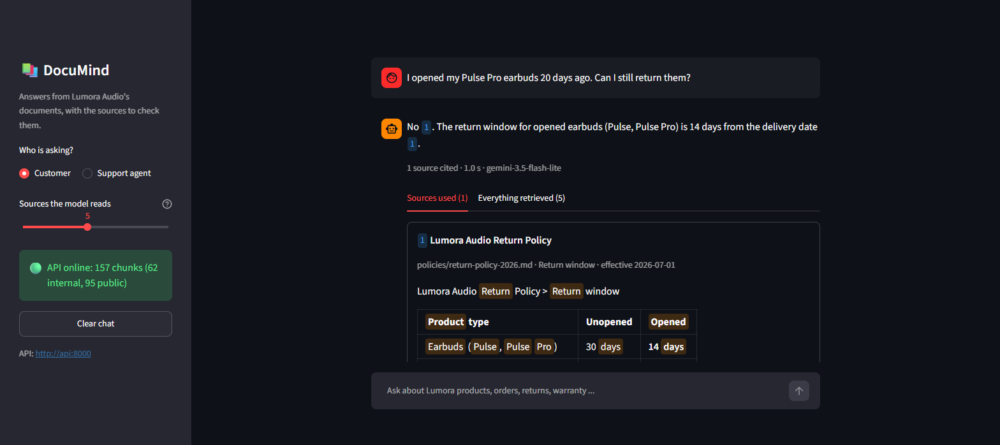
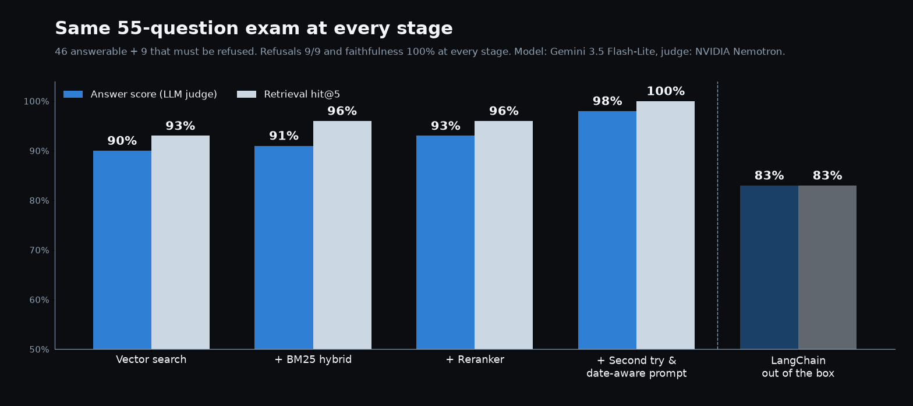

# DocuMind

**Ask a company's documents a question, get an answer with numbered sources, or an honest "I couldn't find this".**

DocuMind is a retrieval-augmented generation (RAG) system built from scratch over the knowledge base of
*Lumora Audio*, a fictional headphone and speaker company: PDF manuals, Markdown policies, CSV support
tickets and Excel price lists, public and internal. Every stage was measured on a 55-question test set
before the next one was added.

> The company and its documents are **synthetic**, written for this project with deliberate traps:
> an old and a new return policy that disagree, the same error code meaning different things on two
> products, prices hidden in spreadsheet rows, internal documents customers must never see, and
> questions the documents do not answer.



## Quick start

Needs Docker and one free LLM key ([Gemini](https://aistudio.google.com/apikey), no credit card).

```bash
cp .env.example .env          # put your GOOGLE_API_KEY in it (and an ADMIN_API_KEY for agent mode)
docker compose up -d --build
```

Open **http://localhost:8501** for the chat, **http://localhost:8000/docs** for the API.
The first start downloads two small local models (~200 MB) and reads all documents into the database;
later starts take seconds. `docker compose stop` stops everything, the data is kept.

## What it does

- **Hybrid search**: vector search (meaning) and BM25 keyword search (exact codes, model names, prices),
  merged with Reciprocal Rank Fusion, all inside PostgreSQL + pgvector.
- **Reranking**: a local cross-encoder re-reads the top 10 together with the question.
- **Grounded answers**: the LLM may only use the numbered sources, cites them as `[1]`, prefers the newest
  version of a policy and replies with a fixed "not found" sentence when the sources do not say.
- **Second try**: only when the first answer is "not found", the LLM rewrites the question into the
  documents' words and the search runs again.
- **Access control**: internal documents are filtered out in the database query for customers; the
  support-agent mode needs an API key.
- **Explainable sources**: every source card shows where that chunk ranked in each step
  (vector, keyword, fused, reranker).
- **Free to run**: embeddings and reranker run locally on CPU; answers come from Gemini's free tier.
  The LLM provider is one setting (`LLM_PROVIDER=gemini | anthropic | nvidia`).

## Architecture

```
 INGEST (once, or POST /ingest)
 data/raw ─▶ loaders (PDF, MD, CSV, XLSX) ─▶ heading-aware chunks ─▶ bge-small embeddings ─▶ Postgres + pgvector
                                                                                             (vectors + full-text)
 QUERY (every question)
 browser ─▶ ui/ (Streamlit) ── HTTP ──▶ app/api.py (FastAPI) ─▶ vector + BM25 ─▶ RRF ─▶ reranker ─▶ prompt ─▶ LLM
                                                                                                          │
                                         "not found"? ─▶ rewrite question ─▶ search again ◀──────────────┘
```

| Container | What it runs |
|---|---|
| `db` | PostgreSQL 17 + pgvector |
| `api` | FastAPI: `POST /ask`, `POST /ingest` (admin key), `GET /health` |
| `ui` | Streamlit chat. Talks to the API only, holds no keys and no models |

## Measured results

Same 55 questions at every stage (46 answerable incl. tables, multi-document and conflicting versions;
9 that must be refused). Retrieval is scored by code; answers by an LLM judge from another model family
(NVIDIA Nemotron). Per-question results of every run: `eval/results/runs/*.json`.

| Stage | Answer score | hit@5 | recall@5 | MRR@10 | Correct refusals | Faithful |
|---|---:|---:|---:|---:|---:|---:|
| Vector search | 90% | 93% | 91% | 0.84 | 9/9 | 100% |
| + BM25 hybrid | 91% | 96% | 94% | 0.86 | 9/9 | 100% |
| + reranker | 93% | 96% | 95% | 0.89 | 9/9 | 100% |
| + second try & date-aware prompt | **98%** | **100%** | **99%** | **0.90** | **9/9** | **100%** |



- Answer model: `gemini-3.5-flash-lite`. Warm API: ~1-3 s per question, most of it the LLM call.
- The second try costs more tokens per question (774 → 992 on average) and only runs after a "not found".
- Honest limits: the test set is small and written by the author; differences of one or two answer points
  are within LLM noise. The retrieval columns are deterministic.

## Run without Docker (development)

```bash
uv sync
docker compose up -d db                       # only the database
uv run uvicorn app.api:app --port 8000        # terminal 1
uv run streamlit run ui/app.py                # terminal 2
uv run pytest                                 # 117 tests; database tests skip when it is down
uv run python eval/run_eval.py --name mine    # the 55-question evaluation
```

## Project layout

```
app/        the product: ingest/, store (pgvector + BM25), retrieve, rerank, rewrite, generate, api
ui/         Streamlit chat (thin client)
eval/       questions.jsonl, run_eval.py, results/runs/ (every measured run, per question)
scripts/    one experiment per stage, each writes a report to eval/results/
tests/      unit tests (fake LLM / fake API) + database tests
data/raw/   the synthetic company documents
```

Stack: Python 3.12, uv, FastAPI, Streamlit, PostgreSQL 17 + pgvector, fastembed
(`BAAI/bge-small-en-v1.5`, `jinaai/jina-reranker-v1-tiny-en`), Gemini / Claude / NVIDIA, Docker Compose.
